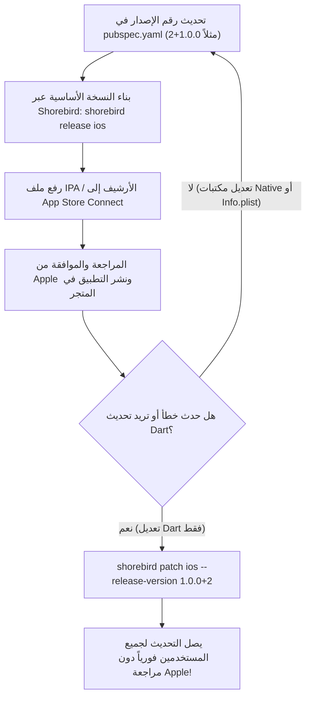

# دليل النشر والتحديث الفوري لتطبيق iOS عبر Shorebird و App Store
# iOS Deployment & Shorebird CodePush Guide - Dhabayih Al-Mamlaka

هذا الدليل مخصص لمطوري التطبيق لشرح كيفية نشر تطبيق **ذَبَائِح المَمْلَكَة (iOS)** على متجر **Apple App Store**، وتفعيل التحديثات الفورية (Over-The-Air / CodePush) عبر **Shorebird** بدون الحاجة لانتظار مراجعة آبل لكل تعديل في كود Dart.

---

## 1. البيانات والمعلومات الفنية للتطبيق (Project Specs)

| البند | القيمة |
| :--- | :--- |
| **اسم التطبيق (App Name)** | ذبائح المملكة (Dhabayih Al-Mamlaka) |
| **معرّف الحزمة (iOS Bundle Identifier)** | `com.zbayhalmmlkh.app` |
| **معرّف تطبيق Shorebird (Shorebird App ID)** | `bb3f73c8-5641-44e1-9ce5-cce609a4a15f` |
| **ملف الإعدادات (Config File)** | [`shorebird.yaml`](./shorebird.yaml) |
| **إصدار التطبيق الأساسي** | يُحدد في `pubspec.yaml` (مثال: `version: 1.0.0+1`) |
| **سيرفر الـ API المربوط** | `https://api.zbayhalmmlkh.network` |

---

## 2. قيود وقوانين متجر آبل (Apple Guidelines & Compliance)

### أ) هل Shorebird متوافق مع شروط متجر آبل (App Store Review Guidelines)؟
**نعم، متوافق بنسبة 100% مع البند 2.5.2 و 3.3.2 من اتفاقية مطوري Apple (Apple Developer Program License Agreement):**
* تسمح آبل بتنزيل وتشغيل الشفرات البرمجية وتحديث الواجهات طالما أنها:
  1. لا تغيّر الوظيفة الأساسية للتطبيق (Primary Purpose of the app).
  2. لا تتجاوز أنظمة الدفع المعتمدة (In-App Purchases) للبضائع الرقمية.
  3. تُستخدم لإصلاح الأخطاء (Bug Fixes)، تحسين تجربة المستخدم، أو إضافة مزايا داخل إطار المتجر والطلب.

> [!IMPORTANT]
> **ممنوع وفقاً لآبل:** لا تستخدم التحديث الفوري (Patch) لتغيير نشاط التطبيق بالكامل (مثلاً تحويل متجر لحوم إلى تطبيق ألعاب أو تطبيق محادثة مشفرة)، لأن هذا يؤدي لحظر الحساب.

---

## 3. قيود Shorebird الفنية: ما الذي يمكن تحديثه وما الذي يتطلب نسخة جديدة كاملة؟

| نوع التعديل | هل يمكن إرساله عبر باتش Shorebird الفوري؟ | الإجراء المطلوب |
| :--- | :---: | :--- |
| **كود Dart والواجهات (Flutter Widgets & Screens)** | ✅ **نعم** | إرسال Patch فوري عبر `shorebird patch ios` |
| **إصلاح أخطاء المنطق (Cubit / Bloc / Services)** | ✅ **نعم** | إرسال Patch فوري عبر `shorebird patch ios` |
| **تعديل الروابط والـ API Endpoints** | ✅ **نعم** | إرسال Patch فوري عبر `shorebird patch ios` |
| **إضافة أو تعديل صور وموارد داخل Dart Assets** | ✅ **نعم** | إرسال Patch فوري عبر `shorebird patch ios` |
| **تثبيت مكتبة Flutter تعتمد على Native Pods جديدة** | ❌ **لا** | بناء Release كامل ورفعه لـ App Store |
| **تعديل في كود Swift أو Objective-C (مجلد ios)** | ❌ **لا** | بناء Release كامل ورفعه لـ App Store |
| **تعديل صلاحيات في `Info.plist` (كاميرا، موقع، إلخ)** | ❌ **لا** | بناء Release كامل ورفعه لـ App Store |
| **تغيير أيقونة التطبيق (App Icon) أو شاشة البداية** | ❌ **لا** | بناء Release كامل ورفعه لـ App Store |
| **تعديل إصدار الحد الأدنى لـ iOS (Deployment Target)** | ❌ **لا** | بناء Release كامل ورفعه لـ App Store |

---

## 4. المتطلبات المسبقة للبناء (Prerequisites)

1. **جهاز macOS (Mac Mini, MacBook, iMac أو سحابة مثل GitHub Actions / Codemagic):**
   * نظام iOS يتطلب حصراً نظام macOS لبناء الأرشيف وتوقيعه بشهادات Apple.
2. **برنامج Xcode** مثبت ومحدث مع أدوات سطر الأوامر (`xcode-select --install`).
3. **حساب Apple Developer مدفوع:**
   * شهادة توزيع (Distribution Certificate).
   * ملف تعريف النشر (App Store Provisioning Profile) لمعرّف الحزمة `com.zbayhalmmlkh.app`.
4. **تثبيت Shorebird CLI على جهاز الماك:**
   ```bash
   curl --proto '=https' --tlsv1.2 -sSf https://raw.githubusercontent.com/shorebirdtech/install/main/install.sh | bash
   ```
5. **تسجيل الدخول في Shorebird:**
   ```bash
   shorebird login
   ```

---

## 5. خطوات دورة العمل الكاملة (Step-by-Step Workflow)



---

### المرحلة الأولى: بناء ورفع النسخة الأساسية (Initial Release to App Store)

تُنفذ هذه الخطوة عند طرح إصدار جديد على متجر آبل:

#### 1. تحديث رقم الإصدار
افتح ملف `pubspec.yaml` وقم بزيادة رقم الـ Build:
```yaml
version: 1.0.0+2 # قم بزيادة رقم الـ build (+2, +3, ...)
```

#### 2. التحقق من توافق المشروع
```bash
shorebird doctor
```

#### 3. بناء نسخة الإصدار الخاصة بـ Shorebird
نفذ الأمر التالي على جهاز الماك:
```bash
shorebird release ios
```
* سيقوم Shorebird ببناء التطبيق وربطه بمحرك Shorebird المخصص، وتوليد ملف الأرشيف (`.xcarchive` أو `.ipa`).
* يتم تسجيل رقم الإصدار وقاعدة البصمة (Artifact Hash) في سيرفرات Shorebird لضمان وصول التحديثات اللاحقة المتوافقة فقط.

#### 4. رفع التطبيق إلى App Store Connect
يمكنك الرفع بإحدى الطرق التالية:
* **الطريقة الأولى (الأسهل عبر Xcode Organizer):**
  افتح Xcode -> Window -> Organizer -> اختر الأرشيف الناتج -> اضغط **Distribute App** -> اختر **App Store Connect** -> وافق على التوقيع والرفع.
* **الطريقة الثانية (عبر تطبيق Apple Transporter):**
  اسحب ملف الـ `.ipa` الناتج وأفلته داخل تطبيق Transporter ثم اضغط **Deliver**.
* **الطريقة الثالثة (سطر الأوامر):**
  ```bash
  xcrun altool --upload-app -f build/ios/ipa/*.ipa -t ios -u "YOUR_APPLE_ID" -p "APP_SPECIFIC_PASSWORD"
  ```

#### 5. إرسال الإصدار للمراجعة في App Store Connect
1. ادخل على [App Store Connect](https://appstoreconnect.apple.com).
2. اختر تطبيق **ذَبَائِح المَمْلَكَة**.
3. أضف النسخة المبنية (`1.0.0 (2)`) إلى إصدار جديد.
4. املأ بيانات الإصدار واضغط **Submit for Review**.
5. بمجرد موافقة آبل ونزول التطبيق للمستخدمين، تصبح جاهزاً لإرسال أي ترقيعات فورية!

---

### المرحلة الثانية: إرسال تحديث فوري بدون مراجعة آبل (Over-The-Air Patching)

عندما تريد إصلاح خطأ في الواجهة، تعديل نصوص، إصلاح حسابات السلة، أو تحديث صفحات العروض:

#### 1. عدّل كود الـ Dart في المشروع
* قم بإجراء التعديلات المطلوبة في مجلد `lib/` (دون لمس ملفات `ios/` أو إضافة مكتبات native جديدة).
* **هام جداً:** لا تغير رقم الإصدار في `pubspec.yaml` عند عمل Patch. يجب أن يبقى نفس رقم إصدار الـ Release المستهدف (مثلاً `1.0.0+2`).

#### 2. إطلاق التحديث الفوري (Patch)
نفّذ الأمر التالي:
```bash
shorebird patch ios --release-version 1.0.0+2
```

* ستقوم Shorebird بمقارنة النسخة الجديدة بالنسخة المرفوعة في الـ Release، واستخراج فرق الكود (Delta/Patch فقط بحجم صغير جداً عادة بالكيلوبايت).
* سيُرفع الـ Patch لسحابة Shorebird ويصبح متاحاً للعملاء فوراً.

#### 3. كيف يستلم العميل التحديث في الهاتف؟
* لأن ملف [`shorebird.yaml`](./shorebird.yaml) يحتوي على `auto_update` مفعل تلقائياً:
  1. عند فتح التطبيق من قِبل المستخدم، يقوم المحرك في الخلفية بالتحقق من وجود Patch جديد عبر شبكة سريعة (CDN).
  2. يتم تنزيل الـ Patch بهدوء في الخلفية دون التأثير على استخدام العميل.
  3. في الفتحة القادمة للتطبيق (Next App Launch)، يعمل التطبيق مباشرةً بالنسخة المحدثة!

---

## 6. التحقق والمراقبة (Verification & Monitoring)

1. **معاينة الباتش قبل تعميمه على المستخدمين (Shorebird Preview):**
   ```bash
   shorebird preview --app-id bb3f73c8-5641-44e1-9ce5-cce609a4a15f
   ```
2. **لوحة تحكم Shorebird (Console):**
   * قم بزيارة [console.shorebird.dev](https://console.shorebird.dev).
   * يمكنك مراقبة:
     * عدد مرات تنزيل الـ Patch لكل دولة ونوع جهاز.
     * نسبة وصول التحديث للأجهزة النشطة.
     * إمكانية تعطيل (Rollback) أي Patch فوراً بضغطة زر واحدة في حال حدوث أي خطأ غير متوقع.

---

## 7. سكريبت أتمتة عبر GitHub Actions (اختياري لمطوري Windows)

إذا كنت تطور على نظام Windows ولا تملك جهاز Mac محلي، يمكنك استخدام السيرفرات السحابية لـ GitHub Actions (Mac Runner) لبناء الـ Release والـ Patch آلياً:

```yaml
# .github/workflows/shorebird_ios.yml
name: Shorebird iOS Release
on:
  workflow_dispatch:

jobs:
  release:
    runs-on: macos-14
    steps:
      - name: Checkout Code
        uses: actions/checkout@v4

      - name: Setup Flutter
        uses: subosito/flutter-action@v2
        with:
          flutter-version: '3.29.0'
          cache: true

      - name: Setup Shorebird
        uses: shorebirdtech/actions/setup-shorebird@v1
        with:
          shorebird-token: ${{ secrets.SHOREBIRD_TOKEN }}

      - name: Install Apple Certificates & Profiles
        # استخدم Fastlane Match أو خطوات تثبيت الشهادات المعتادة

      - name: Build Shorebird Release
        run: shorebird release ios --no-codesign
```

---

## 8. ملخص سريع لأهم الأوامر (Cheat Sheet)

```bash
# فحص جاهزية النظام والبيئة
shorebird doctor

# بناء وتجهيز إصدار جديد لمتجر آبل
shorebird release ios

# إرسال تحديث فوري (باتش) للنسخة الحالية دون متجر آبل
shorebird patch ios --release-version 1.0.0+2

# عرض قائمة الإصدارات المسجلة
shorebird releases list

# مساعدة الأوامر
shorebird --help
```

